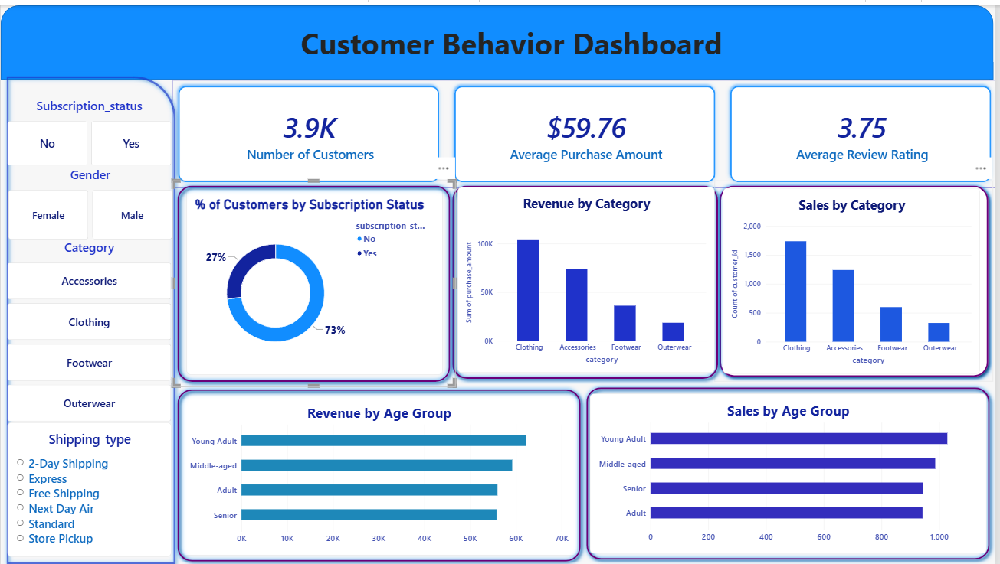

# Customer Shopping Behavior Analysis

## Overview

Customer Shopping Behavior Analysis is an end-to-end data analytics project that explores customer purchasing patterns, spending behavior, product preferences, discount usage, and subscription trends.

The project uses **Python for data cleaning, exploratory data analysis, and feature engineering; PostgreSQL for SQL-based business analysis; and Power BI for interactive data visualization.**

The goal is to transform customer shopping data into meaningful insights that help understand purchasing behavior, compare customer segments, and support data-driven business decisions.

## Tools & Technologies

- **Python** — Data analysis and preprocessing
- **Pandas** — Data manipulation and cleaning
- **NumPy** — Numerical operations
- **Jupyter Notebook** — Data analysis environment
- **Feature Engineering** — Age group creation and purchase frequency transformation
- **PostgreSQL** — Database management and SQL analysis
- **Power BI** — Interactive dashboards, KPI cards, charts, and slicers

## Dataset Description

The dataset contains customer shopping information, including demographic details, purchased products, spending amounts, review ratings, subscription status, and purchasing preferences.

Key attributes include:

- Customer ID, Age, and Gender
- Item Purchased and Category
- Purchase Amount and Review Rating
- Subscription Status
- Shipping Type
- Discount Applied and Promo Code Used
- Previous Purchases
- Payment Method
- Frequency of Purchases

## Project Workflow

### 1. Data Cleaning and Preprocessing

- Loaded and inspected the dataset using Pandas.
- Examined data dimensions, column data types, descriptive statistics, and missing values.
- Handled missing review ratings using category-wise median imputation.
- Standardized column names for easier analysis.
- Prepared the dataset for further analysis.

### 2. Exploratory Data Analysis (EDA)

- Explored customer demographics and purchasing patterns.
- Examined purchase amounts and product categories.
- Investigated customer subscription status and discount usage.
- Analyzed shipping preferences and purchasing frequency.
- Explored patterns across different customer groups.

### 3. Feature Engineering

- Created age groups using quantile-based binning.
- Transformed purchase frequency categories into numerical day values.
- Prepared additional analytical features to support customer behavior analysis.

### 4. SQL Analysis Using PostgreSQL

Developed SQL queries to answer 10 business questions:

1. **Revenue by Gender:** Compared total revenue generated by male and female customers.
2. **Discount-Based Spending:** Identified customers who used discounts but spent at least the average purchase amount.
3. **Product Ratings:** Found the top five products with the highest average review ratings.
4. **Shipping Comparison:** Compared average purchase amounts between Standard and Express Shipping.
5. **Subscription Analysis:** Compared customer counts, average spending, and total revenue between subscribers and non-subscribers.
6. **Discount Rate by Product:** Identified the five products with the highest percentage of discounted purchases.
7. **Customer Segmentation:** Categorized customers into New, Returning, and Loyal segments based on previous purchases.
8. **Top Products by Category:** Identified the top three most-purchased products within each category.
9. **Repeat Buyer Analysis:** Examined subscription status among customers with more than five previous purchases.
10. **Revenue by Age Group:** Analyzed total revenue generated by each age group.

**SQL concepts applied:** Filtering, aggregation, grouping, subqueries, conditional logic using `CASE`, `ROUND`, sorting, Common Table Expressions (CTEs), and window functions using `ROW_NUMBER()`.

## Power BI Dashboard

Developed an interactive Power BI dashboard to present key customer behavior metrics and purchasing trends.

## Power BI Dashboard Preview

### Key Performance Indicators (KPIs)

- **Total Customers:** 3.9K
- **Average Purchase Amount:** $59.76
- **Average Review Rating:** 3.75

### Dashboard Visualizations

- Customer Distribution by Subscription Status
- Revenue by Category
- Sales by Category
- Revenue by Age Group
- Sales by Age Group

### Interactive Filters

- Subscription Status
- Gender
- Category
- Shipping Type

The dashboard allows users to explore customer purchasing patterns and compare metrics across different customer segments.

## Key Business Insights Areas

This project focuses on understanding:

- Revenue contribution by gender and age group.
- Customer spending behavior and discount usage.
- Product ratings and purchasing popularity.
- Spending differences between subscribers and non-subscribers.
- Customer segmentation based on purchase history.
- Subscription behavior among repeat buyers.
- Purchasing patterns across product categories and shipping types.

## Key Learnings

- Practiced data cleaning and exploratory data analysis using Python.
- Applied feature engineering to create meaningful analytical features.
- Developed SQL queries for business problem-solving using PostgreSQL.
- Used aggregations, subqueries, CTEs, and window functions.
- Built an interactive Power BI dashboard with KPIs, charts, and slicers.
- Practiced an end-to-end data analytics workflow from raw data preparation to dashboard reporting.

## How to Explore the Project

1. Open the Jupyter Notebook to review the Python analysis and feature engineering.
2. Explore the SQL query file to understand the business questions and PostgreSQL analysis.
3. Open the Power BI dashboard file in Power BI Desktop to explore the visualizations and interactive filters.

## Author

**Abhay Raghav**

- GitHub: [abhay-raghav5](https://github.com/abhay-raghav5)
- LinkedIn: [Abhay Raghav](https://www.linkedin.com/in/abhay-raghav-ai/)

---

*Developed as a hands-on data analytics project using Python, PostgreSQL, and Power BI.*
